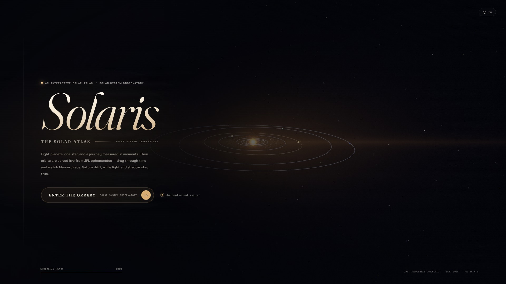
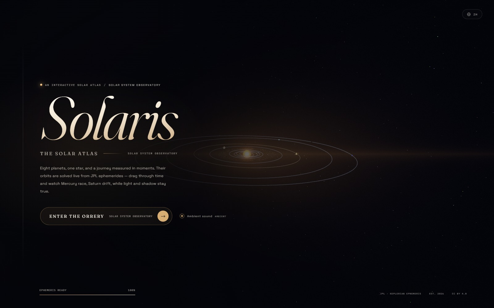
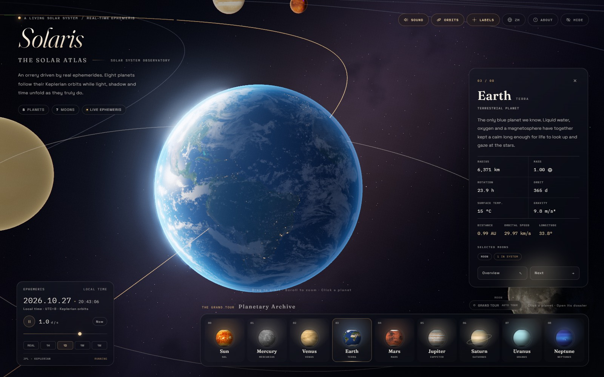
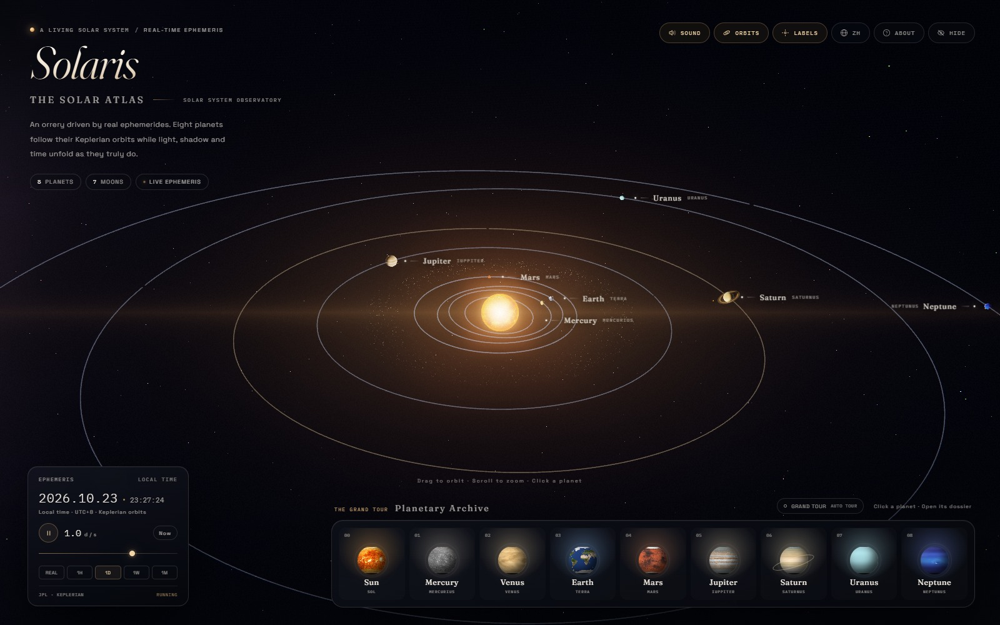

# SOLARIS · The Solar Atlas

[简体中文](README.md) · **English**

**An interactive solar atlas** — a living orrery driven by real ephemerides.

[](https://tiancanxia.github.io/solaris/?lang=en)
[](https://threejs.org/)
[](#browser-support)
[](LICENSE)



> Eight planets, one star, and a journey measured in moments.
> Their orbits are solved live from JPL elements; drag through time and watch Mercury race, Saturn drift — while light and shadow stay true.

**Contents** · [What it is](#what-it-is) · [Highlights](#highlights) · [Controls](#controls) · [Scale & truth](#scale--truth) · [Technical notes](#technical-notes) · [Project structure](#project-structure) · [Run locally](#run-locally) · [Deploy](#deploy) · [Data & credits](#data--credits)

---

## What it is

SOLARIS is not a decorative star chart; it is an observatory console you can operate. At the default rate, time advances at **one day per second**, and every planet’s position is solved each frame from JPL’s approximate Keplerian elements (J2000.0, with centennial rates). The arrangement you see on opening is the real sky of this moment.

You can pause time, cast the date into the past or future, and lean in on any planet; or start the Grand Tour and let it carry you from the Sun to Neptune. Every reading — heliocentric distance, orbital speed, ecliptic longitude — is computed from the simulated instant, never scripted.



*The cover: an orrery waiting to be entered.*

## Highlights

- **Real orbits** — Mercury through Neptune use true semi-major axes, eccentricities, inclinations, longitudes of perihelion and ascending node; eccentric anomaly is solved by Newton’s method. Time can be accelerated, paused, or returned to now in one click.
- **A genuinely bilingual instrument** — a complete Chinese edition and a complete English edition. The globe button in the top bar (or on the cover) switches every label, dossier, ephemeris reading, about panel and the page metadata in place. The choice is remembered in `localStorage` and can be shared with `?lang=en`. The English edition uses Latin names — MERCURIUS, TERRA, SATURNUS — as its scientific second voice.
- **Custom shaders** — per-channel limb darkening and a procedural corona for the Sun; day/night terminator, clouds, city lights and ocean highlights for Earth; atmospheric limb scattering for Venus and the ice giants; radial ring texture and analytic planet shadow for Saturn; a procedural Milky Way dust band.
- **Nine exhibits** — the Sun and eight planets, seven simulated moons (the Moon, the four Galilean moons, Titan and Triton), and an asteroid dust belt that quietly retreats in close-ups.
- **Two ways of looking** — a full view of the whole ecliptic instrument; click any planet and the camera arcs in cinematically while its dossier rises and the other orbits recede, placing the planet in the left two-thirds of the frame.
- **The Grand Tour** — the tour button at the right of the shelf visits the Sun through Neptune in sequence. Dragging the view, clicking the scene or switching dossiers interrupts it immediately and hands control back to you. Adjusting time, sound or hiding the interface will not break the spell.
- **Audible space** — ambient sound is synthesised live with WebAudio: a low solar wind, a long reverb, occasional bells. Focusing a planet rings a soft tone at its own pitch. It can be switched off on the cover.
- **Editorial interface** — locally subset Fraunces, Space Grotesk, IBM Plex Mono and Noto Serif/Sans SC; a design language of “museum glass and brass scales,” with the chosen language as the primary voice.



*Earth in focus: terminator, clouds, city lights and ocean highlights at once.*

## Controls

| Action | Description |
| --- | --- |
| Drag | Orbit the camera |
| Scroll / pinch | Zoom in / out |
| Click a planet, the Sun or a label | Enter its focused view |
| Click empty space | Return to the overview |
| `Space` | Pause / resume time |
| `1` – `8` | Focus Mercury — Neptune |
| `0` | Focus the Sun |
| `←` / `→` | Previous / next body while focused |
| `Esc` | Close panel / return to overview / restore interface |
| `O` | Show / hide orbit lines |
| `L` | Show / hide planet labels |
| `S` | Ambient sound on / off |
| `H` | Hide / show the entire interface |
| `N` | Return to now |
| `E` | Switch between 中文 and English |
| `?` | Open the about panel |
| Grand Tour | Nine stations, interruptible at any time |

All time controls live in the **EPHEMERIS** panel at bottom left: play / pause, a logarithmic speed slider, “Real / 1H / 1D / 1W / 1M” presets, and **Now**.

The language can also be chosen directly in the URL: [`?lang=zh`](https://tiancanxia.github.io/solaris/?lang=zh) or [`?lang=en`](https://tiancanxia.github.io/solaris/?lang=en). Without a parameter, the page follows the browser language.



*The overview: the ecliptic instrument, planet labels and the procedural Milky Way.*

## Scale & truth

This is an instrument and a work of design, so it follows two sets of rules at once.

**Staying true**

- Orbital shapes, eccentricities, inclinations, periods, phases and the current date are all derived from JPL’s approximate elements.
- Physical parameters follow NASA NSSDC Fact Sheets; moon counts use the latest confirmed tallies for 2026.
- Live readings (heliocentric distance, orbital speed, ecliptic longitude) are computed from the simulated instant — never preset or invented.
- Valid range: **1800 — 2050**. This is an approximate ephemeris, not JPL Horizons precision; the Earth row represents the Earth–Moon barycenter.

**Adjusted for the eye**

- Heliocentric distances are monotonically compressed by `d_display = 80 × (r_AU)^0.62` so the inner planets and Neptune can share a frame.
- Planetary radii are enlarged; moon orbits are compressed dramatically (the Moon is about 60 Earth radii away in reality, but about 2.7 visual radii here) so the Earth–Moon system can be seen in focus.
- Planetary rotation is gently slowed in the visuals to avoid strobing when time is accelerated; the time rate itself is not scaled.
- The Milky Way and dust belts are procedural artistic backdrops, not a navigable map of the galaxy.

## Technical notes

**Ephemeris**

- `src/ephemeris.js`: JPL approximate elements → Kepler’s equation → elliptical orbit → ecliptic coordinates → compressed display coordinates.
- The Moon and major moons use real periods and relative inclinations; visual orbit radii are set separately.
- Time is driven by Julian dates; the interface shows local time with the UTC offset in the panel.

**Rendering**

- Custom `ShaderMaterial`s handle all lighting; no conventional lights or PBR, so the Sun, planets, rings and dust share one linear HDR space.
- `EffectComposer`: HalfFloat render target + MSAA → restrained UnrealBloom → a custom final grade (ACES, sRGB, vignette, very light chromatic aberration, film grain and dithering).
- The Sun: procedural noise + per-channel limb darkening + additive corona; sunspot texture sampling disables mipmaps to avoid grazing-angle colour artefacts.
- Saturn’s rings: radial UVs, double-sided transparency, analytic planet shadow and backlit scattering.
- Asteroid belt: InstancedBufferGeometry with orbital motion in the vertex shader; near the camera the instances shrink so no “boulders” enter the frame; the whole belt retreats in focus.
- Star field: 12,500 stars in a single draw call, with temperature colours and a faint twinkle; the Milky Way is a procedural 3D FBM dust band with no seams and no texture.

**Bilingual layer**

- `src/i18n.js` holds one dictionary, two complete editions, and the shared ephemeris/body helpers.
- Static HTML is translated through `data-i18n`, `data-i18n-html`, `data-i18n-aria` and `data-i18n-title` attributes.
- Dynamic surfaces — cards, 3D labels, dossiers, live readings, speed units, toasts and the tour button — are rebuilt in place when the language changes.
- Language detection order: `?lang=` → `localStorage` → `navigator.language` (Chinese for `zh-*`, English otherwise). Switching updates the URL with `history.replaceState`, so the current edition is shareable.
- The page’s `lang` attribute is updated as well, and the two type stacks are re-pointed in CSS, so each edition uses its own typographic voice.

**Performance & compatibility**

- Render resolution adapts between 1× and 1.75× based on sustained frame rate (starting at 1.5×).
- URL switches for lower-end GPUs: `?nomsaa` (no MSAA), `?samples2` (2× MSAA), `?nobloom` (no bloom). Example: `http://localhost:8080/?samples2`.
- In the test environment (Chrome headless, Intel UHD Graphics, 1600×1000, DPR 1) it holds about 58 fps; on a 2× display the adaptive pass settles at 1.25× to keep about 52 fps. Actual performance depends on the GPU.
- All textures are local; there are no runtime network requests.
- **Browser support**: latest Chrome / Edge / Firefox / Safari, with WebGL 2 and hardware acceleration enabled. Not recommended with GPU acceleration disabled.

## Project structure

```text
solaris/
├─ index.html            interface shell and import map
├─ styles.css            museum glass / typography / responsive
├─ src/
│  ├─ main.js            orchestration: rendering, time, interaction, quality
│  ├─ ephemeris.js       JPL elements and Kepler solver
│  ├─ data.js            planet / moon data and dossier copy (zh + en)
│  ├─ i18n.js            bilingual dictionary, detection and body helpers
│  ├─ world.js           scene: Sun, planets, rings, moons, dust, sky
│  ├─ materials.js       all GLSL and the final grade
│  ├─ camera.js          cinematic camera direction
│  ├─ ui.js              cards, dossier, ephemeris, labels, tour entry
│  └─ audio.js           WebAudio soundscape
├─ lib/
│  ├─ three/             three.js r170 (MIT)
│  └─ addons/            OrbitControls, EffectComposer, RenderPass,
│                        ShaderPass, UnrealBloomPass and dependencies (MIT)
├─ fonts/                local fonts and Chinese subsets
├─ textures/             planets, Earth clouds / night / specular, Saturn rings
├─ preview/              README screenshots (zh + en)
├─ server.mjs            zero-dependency local server
├─ start.cmd / start.sh  one-click launch
├─ LICENSES.md           third-party assets and data notices
├─ README.md             Chinese edition
├─ README.en.md          English edition
└─ package.json
```

## Run locally

This page uses native ES Modules and WebGL 2, so **double-clicking `index.html` will not work** (browsers restrict modules and textures under `file://`). Serve it over local HTTP:

```bash
git clone https://github.com/TiancanXia/solaris.git
cd solaris
```

**Windows**

```bat
start.cmd
```

**macOS / Linux**

```bash
./start.sh
```

**Any platform, manually**

```bash
python -m http.server 8080      # or python3 -m http.server 8080
# or
node server.mjs                 # npm start also opens the browser
```

Then open <http://localhost:8080/>. Append `?lang=en` or `?lang=zh` to choose an edition.

No `npm install`, no build step. three.js, fonts and textures are self-hosted; it runs offline.

## Deploy

This is a pure static site — no build, no server-side logic.

- **GitHub Pages**: published from the root of `main` at <https://tiancanxia.github.io/solaris/>; the English edition is the same URL with `?lang=en`. See Settings → Pages to inspect or reconfigure.
- **Any static host**: Vercel, Netlify, Cloudflare Pages, nginx or object storage can serve the whole directory; the entry point is `index.html`.
- Hosting under a sub-path (e.g. `/solaris/`) needs no path changes — everything inside the project is relative.

## Data & credits

- Orbital elements: **JPL Solar System Dynamics**, E. M. Standish, *Approximate Positions of the Planets* (1800–2050).
- Physical parameters: **NASA NSSDC Planetary Fact Sheets**; moon counts follow the IAU / Wikipedia tallies confirmed in 2026.
- Planet textures: **Solar System Scope**, [solarsystemscope.com/textures](https://www.solarsystemscope.com/textures/), **CC BY 4.0**. Resized and recompressed for WebGL.
- Earth specular map: **three.js examples** (MIT).
- Rendering library: **three.js r170** (MIT; license bundled with the library).
- Fonts: Fraunces, Cormorant Garamond, Space Grotesk, IBM Plex Mono, Noto Serif SC and Noto Sans SC, all under the **SIL Open Font License 1.1**, downloaded from Google Fonts and self-hosted.

Full attribution and the CC BY 4.0 notice are in [LICENSES.md](LICENSES.md). **If you redistribute this project, please keep that file and its attribution to Solar System Scope.**

## License

- Original code and interface: **MIT**, see [LICENSE](LICENSE).
- Planet textures: **CC BY 4.0**, © Solar System Scope.
- three.js and its addons: **MIT**.
- Fonts: **SIL OFL 1.1**.

## Author

**TiancanXia** · [GitHub](https://github.com/TiancanXia)

If this project made you look at the sky a little longer, a star is welcome; issues and suggestions are welcome too at [GitHub Issues](https://github.com/TiancanXia/solaris/issues).

> “The only known place where the sky is drawn.” — about Earth, and about this little observatory.

---

*SOLARIS · Solar System Observatory · 2026*
