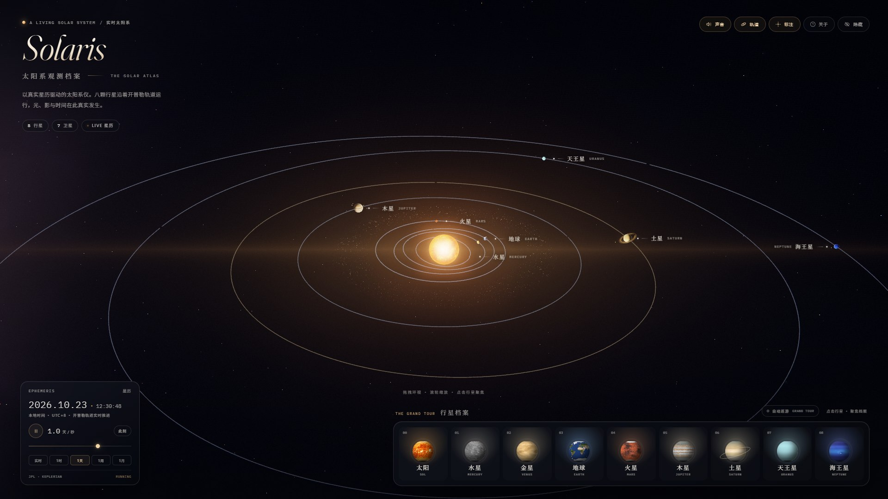
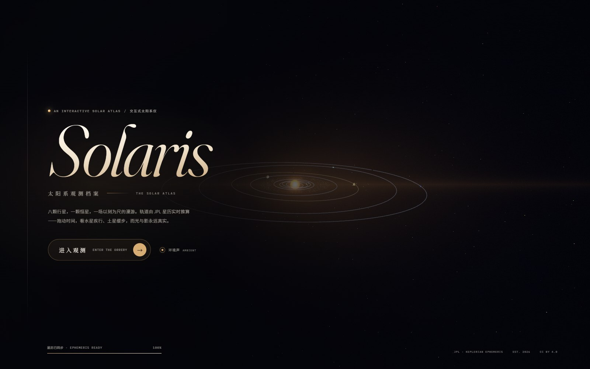
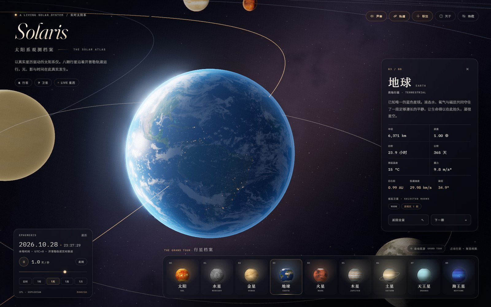
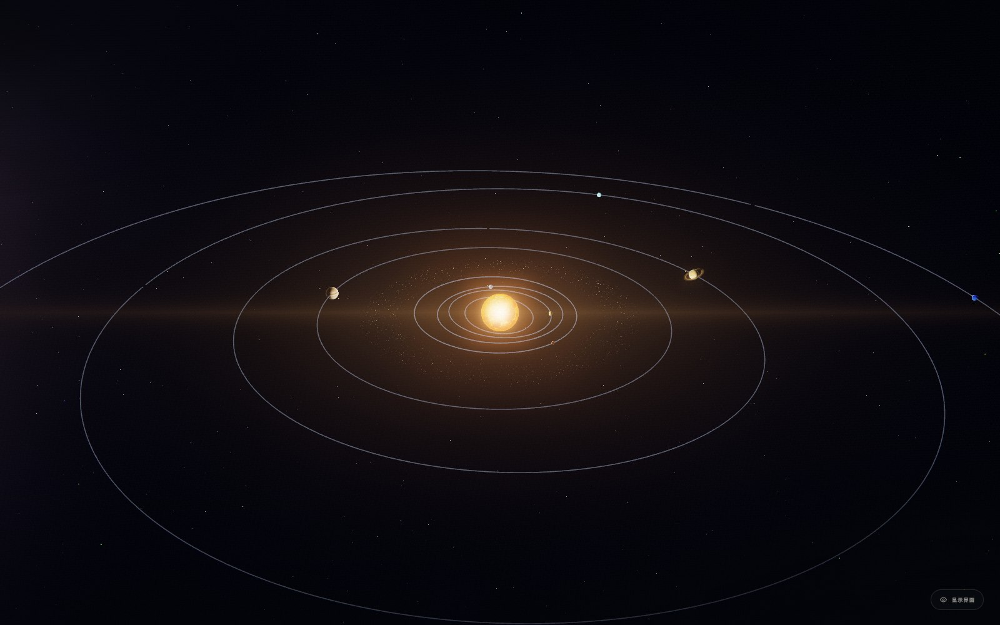

# SOLARIS · 太阳系观测档案

**An interactive solar atlas** — 一座由真实星历驱动的、活的太阳系仪。

[](https://tiancanxia.github.io/solaris/)
[](https://threejs.org/)
[](#浏览器支持)
[](LICENSE)



> 八颗行星，一颗恒星，一场以刻为尺的漫游。
> 轨道由 JPL 近似根数实时推算；拖动时间，看水星疾行、土星缓步，而光与影永远真实。

**目录** · [它是什么](#它是什么) · [亮点](#亮点) · [操作](#操作) · [比例与真实](#比例与真实) · [技术档案](#技术档案) · [项目结构](#项目结构) · [本地运行](#本地运行) · [部署](#部署) · [数据与授权](#数据与授权)

---

## 它是什么

SOLARIS 不是一张装饰性星图，而是一份可被操作的观测档案。默认速度下，时间以 **1 天 / 秒** 推进；行星位置由 JPL 的近似轨道根数（J2000.0，带世纪变率）逐帧解算，打开页面时看见的便是此刻天空中的真实排列。

你可以暂停时间、把日期拨向过去或未来，点击任意行星俯身细看；也可以打开自动巡游，让它带你从太阳出发，一路走到海王星。所有读数——日心距、轨道速度、日心黄经——都由当前模拟时刻直接计算，不预设、不编造。

**English** — SOLARIS is an interactive orrery driven by real ephemerides. Planetary positions are solved per frame from JPL approximate Keplerian elements (1800–2050); lighting, atmospheres, rings, the Milky Way and ambient audio are generated entirely in code. Vanilla ES modules, WebGL 2 and three.js r170 — no build step, no runtime dependencies, no external requests.



*封面：一座等待进入的太阳系仪。*

## 亮点

- **真实轨道**：水星到海王星均采用真实半长轴、偏心率、倾角、近日点与升交点经度，Newton 法解偏近点角。日期可任意加速、暂停，或一键回到此刻。
- **自写着色器**：日面每通道临边昏暗与程序化日冕；地球的昼夜面、云层、城市灯光与海面高光；金星与冰巨星的大气边缘散射；土星环的径向纹理与行星投阴影；程序化银河尘埃带。
- **九件藏品**：太阳与八大行星，连同七颗被模拟的主要卫星（月球、四颗伽利略卫星、泰坦、特里同），以及一条在近景中悄然退场的小行星尘埃带。
- **两种凝视**：全景俯瞰整座黄道仪；点击任何行星，镜头以电影感弧线飞近，档案浮出，其他轨道退后，行星被放到画面的左侧三分之二处。
- **自动巡游**：底部档案栏右侧的「自动巡游」会依次造访太阳至海王星；拖动视角、点击场景或切换档案都会立刻中断它，把控制权交还给你。调整时间、声音或隐藏界面不会打断巡游——那可以是一段没有边框的独享旅程。
- **可听的空间**：环境声由 WebAudio 实时合成——低频太阳风、长混响与偶尔的钟声。聚焦不同行星时，会响起对应音高的柔和清音。首次进入时可在封面关闭。
- **编辑式界面**：Fraunces、Space Grotesk、IBM Plex Mono 与 Noto Serif/Sans SC 本地子集；以「博物馆玻璃 + 黄铜刻度」为设计语言，中文为主、英文为科学旁注。



*聚焦地球：昼夜线、云层、城市灯光与海面高光同时在场。*

## 操作

| 操作 | 说明 |
| --- | --- |
| 拖拽 | 环绕视角 |
| 滚轮 / 双指捏合 | 推近 / 拉远 |
| 点击行星、太阳或标签 | 进入聚焦视角 |
| 点击空白处 | 从聚焦返回全景 |
| `Space` | 暂停 / 继续时间 |
| `1` – `8` | 聚焦水星 — 海王星 |
| `0` | 聚焦太阳 |
| `←` / `→` | 聚焦时切换上一颗 / 下一颗 |
| `Esc` | 关闭面板 / 返回全景 / 恢复界面 |
| `O` | 显示 / 隐藏轨道线 |
| `L` | 显示 / 隐藏行星标注 |
| `S` | 环境声开关 |
| `H` | 隐藏 / 显示整个界面，独享星空 |
| `N` | 回到此刻 |
| `?` | 打开关于面板 |
| 自动巡游 | 九站连续观测，可随时打断 |

所有时间控制都在左下角的 **EPHEMERIS** 面板：播放 / 暂停、对数速度滑杆、「实时 / 1时 / 1天 / 1周 / 1月」预设，以及「此刻」。



*全景：黄道仪、行星标注与程序化银河。*

## 比例与真实

这是一座仪器，也是一件作品，因此同时遵循两套规则：

**保持真实**

- 行星的轨道形状、偏心率、倾角、周期、相位与当前日期均由 JPL 近似轨道根数推算。
- 行星物理参数取自 NASA NSSDC Fact Sheets；卫星数量采用 2026 年最新确认数据。
- 实时读数（日心距、轨道速度、日心黄经）都由当前模拟时刻直接计算，不预设、不编造。
- 适用区间：**1800 — 2050 年**。位置模型为近似星历，非 JPL Horizons 级精密星历；Earth 一行对应地月质心。

**为观看而调整**

- 日心距经过单调压缩：`d_display = 80 × (r_AU)^0.62`，让内行星与海王星能同时进入画面。
- 行星半径被放大；卫星轨道距离被大幅压缩（例如月球实际约 60 个地球半径，此处约 2.7 个视觉半径），以便在聚焦时看见地月系统。
- 行星自转在视觉上被温和减缓，避免时间加速时出现频闪；时间速率本身不缩放。
- 银河、尘埃带为程序化艺术化背景，不是可导航的星系地图。

## 技术档案

**星历**

- `src/ephemeris.js`：JPL 近似根数 → 开普勒方程 → 椭圆轨道 → 黄道坐标 → 视觉压缩坐标。
- 月球与主要卫星使用真实周期与相对倾角，视觉轨道半径另行设定。
- 时间以儒略日驱动；显示为本地时间，并在面板中标注 UTC 偏移。

**渲染**

- 自定义 `ShaderMaterial` 完成全部照明，不使用传统灯光 / PBR，保证太阳、行星、环与尘埃在同一线性 HDR 空间内。
- `EffectComposer`：HalfFloat 渲染目标 + MSAA → 收敛的 UnrealBloom → 自写最终调色（ACES、sRGB、暗角、极轻色差、胶片颗粒与抖动）。
- 太阳：程序化噪声 + 逐通道临边昏暗 + 加性日冕；日面纹理关闭 mipmap 采样，避免掠射角色彩伪影。
- 土星环：径向 UV、双面透明、解析式行星阴影与背光散射。
- 小行星带：InstancedBufferGeometry + 顶点着色器轨道运动；近景自动缩小以避免「巨石」入镜；聚焦时整条尘埃带退场。
- 星空：单次 draw call 的 12,500 颗恒星，带温度色与极轻闪烁；银河为程序化三维 FBM 尘埃带，无接缝、无贴图。

**性能与兼容性**

- 渲染分辨率会根据持续帧率在 1× 与 1.75× 之间自适应（默认以 1.5× 起始）。
- 可通过 URL 参数降压：`?nomsaa`（关闭 MSAA）、`?samples2`（2× MSAA）、`?nobloom`（关闭辉光）。例如 `http://localhost:8080/?samples2`。
- 在测试环境（Chrome headless，Intel UHD Graphics，1600×1000，DPR 1）中稳定约 58 fps；2× 屏幕下自适应降至 1.25× 以维持约 52 fps。实际表现取决于 GPU。
- 所有纹理均已本地化；运行时无任何外部网络请求。
- **浏览器支持**：最新版 Chrome / Edge / Firefox / Safari，需 WebGL 2 与硬件加速。不建议在关闭 GPU 加速的环境中使用。

## 项目结构

```text
solaris/
├─ index.html            界面骨架与导入映射
├─ styles.css            博物馆玻璃 / 排版 / 响应式
├─ src/
│  ├─ main.js            编排：渲染、时间、交互、性能
│  ├─ ephemeris.js       JPL 根数与开普勒解算
│  ├─ data.js            行星 / 卫星数据与档案文案
│  ├─ world.js           场景：太阳、行星、环、卫星、尘埃、天空
│  ├─ materials.js       全部 GLSL 与最终调色
│  ├─ camera.js          电影感镜头导演
│  ├─ ui.js              标本卡、档案、星历、标注、巡游入口
│  └─ audio.js           WebAudio 环境声
├─ lib/
│  ├─ three/             three.js r170（MIT）
│  └─ addons/            OrbitControls、EffectComposer、RenderPass、
│                        ShaderPass、UnrealBloomPass 及其依赖（MIT）
├─ fonts/                本地字体与中文子集
├─ textures/             行星、地球云 / 夜光 / 高光、土星环
├─ preview/              README 截图
├─ server.mjs            零依赖本地服务器
├─ start.cmd / start.sh  一键启动
├─ LICENSES.md           第三方素材与数据授权
└─ README.md
```

## 本地运行

本页面使用原生 ES Modules 与 WebGL 2，**不能直接双击 `index.html`**（浏览器会以 `file://` 限制模块与纹理加载）。请通过本地 HTTP 服务器打开：

```bash
git clone https://github.com/TiancanXia/solaris.git
cd solaris
```

**Windows**

```bat
start.cmd
```

**macOS / Linux**

```bash
./start.sh
```

**任意平台手动启动**

```bash
python -m http.server 8080      # 或 python3 -m http.server 8080
# 或者
node server.mjs                 # npm start 会同时打开浏览器
```

然后在浏览器打开 <http://localhost:8080/>。

无需 `npm install`、无需构建。three.js、字体、纹理全部已随项目自托管，断网亦可运行。

## 部署

本项目是纯静态站点，无需构建、无需服务器端逻辑。

- **GitHub Pages**：已从 `main` 分支根目录发布，在线地址为 <https://tiancanxia.github.io/solaris/>。仓库 Settings → Pages 中可查看或重新配置。
- **任意静态托管**：Vercel、Netlify、Cloudflare Pages、nginx 或对象存储均可直接托管整个目录；入口为 `index.html`。
- 若托管在子路径下（如 `/solaris/`），无需修改任何路径——项目内部全部使用相对路径。

## 数据与授权

- 轨道根数：**JPL Solar System Dynamics**，E. M. Standish，*Approximate Positions of the Planets*（1800–2050）。
- 物理参数：**NASA NSSDC Planetary Fact Sheets**；卫星数量参考 IAU / 维基百科 2026 年确认列表。
- 行星纹理：**Solar System Scope**，[solarsystemscope.com/textures](https://www.solarsystemscope.com/textures/)，**CC BY 4.0**。为适配 WebGL 已做缩放与重新压缩。
- 地球高光图：**three.js examples**（MIT）。
- 渲染库：**three.js r170**（MIT，许可证随库附带）。
- 字体：Fraunces、Cormorant Garamond、Space Grotesk、IBM Plex Mono、Noto Serif SC、Noto Sans SC，均为 **SIL OFL 1.1**，经 Google Fonts 下载并本地化。

完整授权信息与 CC BY 4.0 署名见 [LICENSES.md](LICENSES.md)。**分发或再发布本项目时，请保留该文件及其中对 Solar System Scope 纹理的署名。**

## 许可证

- 本项目原创代码与界面：**MIT**，见 [LICENSE](LICENSE)。
- 行星纹理：**CC BY 4.0**，版权归 Solar System Scope 所有。
- three.js 及其 addons：**MIT**。
- 字体：**SIL OFL 1.1**。

## 作者

**TiancanXia** · [GitHub](https://github.com/TiancanXia)

如果这个项目让你多看了星空一会儿，欢迎点一个 Star；有问题或建议可以开 [Issue](https://github.com/TiancanXia/solaris/issues)。

> 「已知唯一会把星空画下来的地方。」——关于地球，也关于这座小小的观测站。

---

*SOLARIS · Solar System Observatory · 2026*
